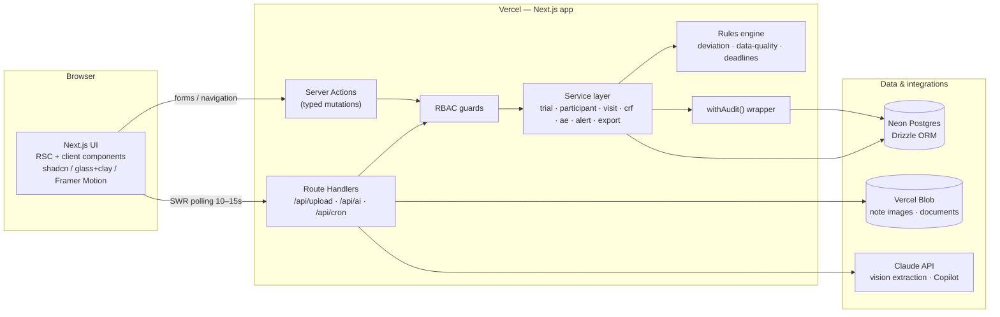
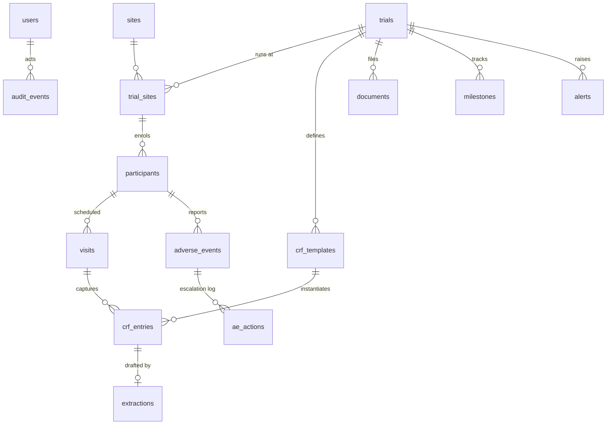

# AYUSPHERE Special Extraction — Presentation Intelligence

**Repository:** `vansh459_AyuSphere` (`https://github.com/vansh459/AyuSphere`, Team Bob The Builder)
**Generated:** 2026-09-30
**Files analyzed:** `README.md` (2.8 KB), `docs/architecture.md` (17.4 KB), `docs/gap-analysis.md` (13 KB), `docs/gap-plan.md` (16.4 KB), `docs/technology.md` (10.4 KB), `docs/uat/Judge_Demo_Script.md` (4.1 KB) + `.pdf` (1.31 MB), 7 UAT guides (0.4-3.3MB), `docs/uat/Tech_Security_Guide.md` (17KB)

## 1. AI Claims (from README + architecture)

```markdown
# AyuSphere

AI-assisted Clinical Research Intelligence Platform for Ayurveda — SIH26046
(AIIA Clinical Trials Dashboard). Team **Bob The Builder**.

Full documentation lives in [`docs/`](docs/): development plan,
architecture, technology, application workflows, ADR decision log, the
test-gated task board, and the [PS gap analysis](docs/gap-analysis.md) with
its [gap-fill plan](docs/gap-plan.md) (Phases 7–10).

## Stack

Next.js 16 (App Router) + TypeScript · Neon Postgres + Drizzle · Auth.js v5
(7 roles, JWT) · Claude API (Doctor Note OCR/extraction + grounded Copilot) ·
Tailwind v4 + hand-owned shadcn-style components · Framer Motion ·
Vitest + **PGlite** (in-process Postgres — **no Docker anywhere**, D-019).

## Quickstart

```bash
pnpm install
cp .env.example .env.local   # fill DATABASE_URL (Neon), AUTH_SECRET, ANTHROPIC_API_KEY
pnpm db:migrate              # apply migrations to Neon
pnpm db:seed                 # deterministic synthetic demo data (D-016)
pnpm dev
```

Demo logins (password `Demo@1234`): `pi@aiia.demo`, `coordinator@aiia.demo`,
`monitor@aiia.demo`, `ethics@aiia.demo`, `pv@aiia.demo`, `admin@aiia.demo`,
`regulator@aiia.demo` (read-only).

## Tests (the task gates)

```bash
pnpm verify      # runs typecheck and full vitest suite
pnpm test        # 157 tests: domain rules + services on PGlite + static design QA
pnpm typecheck
pnpm build
```

See [CONTRIBUTING.md](CONTRIBUTING.md) for contribution guidelines, architecture conventions, and development setup.

Every task in [`docs/tasks.md`](docs/tasks.md) shipped only after its
test gate passed. Key suites: lifecycle state machine, ALCOA+ audit atomicity,
enrolment guards, visit windows, CRF immutability + versioned corrections,
AE escalation clock, alert idempotency/auto-resolve, the full Doctor Note
extraction pipeline (mocked Claude), Copilot grounding (declines on empty
retrieval), FHIR/SDTM exports, regulator read-only, and the
one-font/two-sizes design rule enforced statically.

## Notes

- Trial-level metadata can be REAL public CTRI registry records (titles, CTRI
  numbers, interventions, sponsors, sites/states) scraped politely by
  `scripts/scrape/ctri_scrape.py` (crawl4ai, pip-only — no Docker) and seeded
  via `pnpm db:seed:real` (idempotent; see D-021). **All participant-level
  data is synthetic** (`src/db/seed.ts` / `src/db/seed-real.ts`, fixed faker
  seed). No real personal data may enter any environment.
- The participants table has **no identifier columns** — de-identification by
  schema.
- `audit_events` is insert-only; every mutation commits inside `withAudit()`.
- Doctor Note drafts never auto-commit: low-confidence and flagged fields must
  be explicitly confirmed, and only the PI can approve into the record.

```

**AI architecture (from docs/architecture.md snippet):**
```markdown
# AyuSphere — Architecture Document

System architecture for the AyuSphere CTMS. Stack rationale lives in [technology.md](technology.md), decisions in [decisions.md](decisions.md), end-to-end flows in [workflow.md](workflow.md).

---

## 1. System overview

Single Next.js full-stack application (D-001) on Vercel, backed by Neon Postgres, calling the Claude API for the two AI capabilities, storing files in Vercel Blob.



**Request paths**

- **Reads:** RSC pages query the service layer directly on the server; client dashboards revalidate through lightweight GET route handlers with SWR (D-011).
- **Writes:** always server actions → RBAC guard → Zod parse → service → rules evaluation → Drizzle transaction → audit event. No client ever touches the DB shape directly.
- **AI:** route handlers only (`/api/ai/extract`, `/api/ai/copilot`) so streaming and file handling stay off the action path.
- **Cron:** `/api/cron/alerts` (Vercel Cron — daily on Hobby, 10 min on Pro; write-time evaluation covers intra-day) sweeps time-based alert rules (overdue visits, approaching AE deadlines) that writes alone can't trigger.

## 2. Layered architecture

| Layer | Location | Responsibility | Rule |
|---|---|---|---|
| Presentation | `src/app`, `src/components` | Pages, forms, charts, motion | No business logic; renders service DTOs |
| Application | server actions + `src/services` | Use-cases, transactions, audit | Every mutation wrapped in `withAudit()` (D-010) |
| Domain | `src/lib/schemas`, `src/lib/rules` | Zod schemas, lifecycle state machine, deviation/data-quality/deadline rules | Pure TypeScript, unit-testable, no I/O |
| Data | `src/db` | Drizzle schema, queries, seed | Only services import it |
| Integration | `src/lib/ai`, export builders | Claude prompts + parsers, FHIR/SDTM mappers | AI output parsed through domain Zod schemas — AI can never bypass validation (D-012) |

## 3. Data model

### 3.1 Entity relationships



### 3.2 Tables (Drizzle schema, CDASH-aligned naming — D-017)

| Table | Key fields | Notes |
|---|---|---|
| `users` | id, email, password_hash, name, **role** (enum: `pi · coordinator · monitor · ethics · pv · admin · regulator`), site_id?, active | Seeded demo user per role |
| `trials` | id, ctri_number?, title, protocol_code, study_type (interventional/observational), phase, intervention (Ayurveda formulation, dosage form), target_enrollment, **stat
```

**Analysis:**
- **AI Input:** Doctor Note text/images (Vercel Blob), trial docs for Copilot grounding, alert thresholds.
- **Processing:** `src/app/api/ai/extract/route.ts:1` Claude OCR/extraction (Anthropic SDK 0.125, low-confidence flag, draft never auto-commits, must confirm flagged fields, only PI can approve via `api/ai/approve`), `src/app/api/ai/copilot/route.ts:1` grounded Copilot (declines on empty retrieval, LangChain/Groq), `src/app/api/guide/route.ts:1` Sphera guide (Groq).
- **Model/API:** Claude (Anthropic SDK) + Gemini fallback + Groq (Sphera) — prompt-based, external LLM API, not trained model. API keys in env (`ANTHROPIC_API_KEY`, `GEMINI_API_KEY`, `GROQ_API_KEY`), configurable in Settings → AI Model (overrides env per `docs/technology.md`).
- **Output:** Extracted fields (draft), grounded answer, approved record (via withAudit).
- **Evidence:** `tests/extraction.test.ts:1` 11KB mocked Claude pipeline, `tests/copilot.test.ts:1` 4KB declines, `tests/ai-provider.test.ts:1` 7KB, `tests/guide-chat.test.ts:1` 9KB.
- **Claim vs Implementation:** **IMPLEMENTED** (external LLM API) — not trained model. Demo data synthetic, no real PHI. See `analysis/vansh459_AyuSphere/REPO_ANALYSIS.md:15`.

## 2. CTRI (from README + scripts)

```markdown
# AyuSphere ↔ SIH26046 — Gap Analysis

Requirement-by-requirement trace of the **official problem statement** (SIH26046,
Ministry of Ayush / All India Institute of Ayurveda — *"AIIA Clinical Trials
Dashboard — a real-time, cloud-based, GCP-compliant CTMS for Ayurveda research,
with CDISC/FHIR-interoperable data, role-based KPIs, and integrated ethics,
regulatory (CTRI / NDCT Rules 2019) and pharmacovigilance tracking"*) against
what is actually implemented in this repository — verified in **code**, not
docs claims.

Status legend: ✅ **Built** (working, test-gated) · ◐ **Partial** (core exists,
PS asks for more) · ✖ **Missing** (nothing in code) · 📄 **Narrative**
(hosting/legal posture — documented caveat, correctly out of hackathon scope).

The fill plan for every ◐/✖ row lives in [gap-plan.md](gap-plan.md) (task IDs
`T7.x`–`T10.x`), scheduled on the task board in [tasks.md](tasks.md).

---

## 1. Expected-solution requirements (the scored list)

| PS requirement (quoted) | Status | Evidence in repo | Gap | Fill |
|---|---|---|---|---|
| "a real-time portfolio view with per-study drill-down" | ✅ | `/dashboard` (`src/services/dashboard.ts`), trial detail `/trials/[id]`; SWR 10–15 s polling (D-011: PS "real-time" = decision latency) | — | — |
| "configurable KPIs and alerting" | ✅ | **Closed by T7.2 (D-023):** `alert_config` in `app_settings` (lag threshold, AE warning window, milestone lookahead, monitoring cadence, AE/SAE deadline-rule table) edited from the admin "Alerts & Deadlines" Settings card, Zod-validated, audited; `sweepAlerts` and AE capture read it with built-in defaults (`src/services/settings.ts`, `tests/alert-config.test.ts`) | — (was ◐) | done |
| "strictly role-based access" | ✅ | 7 roles exactly as the PS names them (`src/lib/rbac.ts` matrix; nav from matrix in `src/lib/nav.ts`; service-level `assertCan`); `tests/auth-rbac.test.ts`, `tests/regulator.test.ts` | — | — |
| "an immutable, ALCOA+-compliant audit trail" | ✅ | `withAudit()` wraps every mutation in the same transaction (`src/lib/audit.ts`); insert-only `audit_events`; audit browser `/audit`; corrections are versioned, never in-place | — | — |
| "CDISC-aligned data models" | ✅ | CDASH-aligned naming from creation (D-017), CRF template fields carry `cdashVar` (`src/db/schema.ts`) | — | — |
| "HL7 FHIR R4 / ABDM interoperability with EDC and the hospital information system" | ✅ | **Closed by T9.3 (D-026):** live authenticated FHIR R4 read endpoints (`GET /api/fhir/Bundle/[trialId]`, `GET /api/fhir/ResearchStudy/[id]`, `application/fhir+json`, audited, regulator read-only) + inbound `POST /api/fhir/import` mapping EDC/HIS Observation bundles to **draft** CRF entries through the visit template (never auto-approved; `src/services/fhir-import.ts`, `tests/fhir-api.test.ts`); ABDM posture documented honestly (FHIR endpoints = the ABDM-compatible building block; ABHA linkage stays outside the de-identified schema, stated as roadmap) | — (was ◐) | done |
| "an integrated pharmacovi
```

**Evidence:** `scripts/scrape/ctri_scrape.py:1` (crawl4ai, pip-only, no Docker) scrapes real public CTRI registry records (titles, CTRI numbers, interventions, sponsors, sites/states) politely, seeds via `pnpm db:seed:real` idempotent (`src/db/seed-real.ts` + `seed.test.ts` 2.8KB). **All participant-level data is synthetic** (`src/db/seed.ts` fixed faker seed, no identifier cols by schema). Participants table has no identifier columns — de-identification by schema. See `analysis/vansh459_AyuSphere/CLAIM_VS_EVIDENCE.md:1` — CTRI **IMPLEMENTED** (scrape, not official API).

## 3. FHIR

- **Claim:** FHIR R4 ResearchStudy/Subject (README)
- **Code:** `src/app/api/fhir/Bundle/[trialId]/route.ts:1`, `src/app/api/fhir/ResearchStudy/[id]/route.ts:1`, `src/app/api/fhir/import/route.ts:1`, `tests/fhir-api.test.ts:1` 8KB (PGlite). **IMPLEMENTED** per matrix (FHIR Bundle + import). See `REPO_ANALYSIS.md:11`.

## 4. CDISC

- **Claim:** CDISC SDTM/CDASH (README)
- **Code:** SDTM datasets via `src/app/api/export/route.ts:1`, `tests/exports.test.ts:1` 10KB, `tests/dictionaries.test.ts:1` (MedDRA demo). **IMPLEMENTED** per matrix (CDISC datasets/exports), but mapping heuristic: FHIR↔CDISC mapping **PARTIALLY IMPLEMENTED** (both exist separate, no explicit mapping file found via `mapping` search — see REPO_ANALYSIS 12).

## 5. UAT (from docs/uat/*.pdf + .md)

**Files:** 1 Judge_Demo_Script.md (4.1KB) + .pdf (1.31MB) + 7 UAT guides (Administrator 3.32MB, PI 2.83MB, Coordinator 1.91MB, Pharmacovigilance 1.25MB, Monitor 667KB, Ethics 466KB, Regulator 529KB) + Tech_Security_Guide.md 17KB + .pdf 155KB.

**Judge Demo Script snippet:**
```markdown
# AyuSphere — Judge Demo Script (≈8 minutes)

**SIH26046** · Ministry of Ayush · All India Institute of Ayurveda
Live demo: `https://ayusphere-three.vercel.app` · every role signs in with password `Demo@1234`
(pi@ / coordinator@ / monitor@ / ethics@ / pv@ / admin@ / regulator@ — all `aiia.demo`)

Scored axes: **1** data accuracy & integrity · **2** timeliness of safety & regulatory reporting · **3** interoperability conformance · **4** access-control & audit completeness.
PDF version with live screenshots: `Judge_Demo_Script.pdf` (regenerate any time: `pnpm tsx scripts/build-uat-guides.ts`).

---

## 0:00 · PI — role-tailored entry `axis 4`
1. Sign in as **pi@aiia.demo** — the dashboard is role-tailored: signing queue, open data queries, due visits.
2. Click the leaf orb — **Sphera** greets by name and role (it remembers past conversations).

> **Say:** Seven enforced roles, each with its own dashboard. Even the in-app guide only knows THIS role's screens.

## 1:00 · PI — signed CRF approval `axis 1`
1. **Visit Schedule** → open a due visit → fill the e-CRF (ranges enforced) → **Save & submit for approval**.
2. Enter your password and click **Sign & approve** — a GCP electronic signature: password re-verified, SHA-256 hash of the record stored.

> **Say:** Approval is not a click — it is a signature. The hash lands in the immutable audit trail.

## 2:30 · PI — coded SAE capture `axis 2`
1. **Adverse Events** → **Capture** tab → pick the participant, type "Nausea" (MedDRA picker auto-codes), suspected formulation "Ashwagandha churna" (WHODrug picker), seriousness **SAE** → **Capture**.
2. The **Open AEs** tab shows the new SAE with its escalation clock already counting down.

> **Say:** Coded to MedDRA and WHODrug demo dictionaries; the NDCT-style deadline clock starts at capture — and the rules are admin-configurable, not hard-coded.

## 3:30 · PV — signed reporting, CIOMS, DSMB, NPvCC `axis 2`
1. Switch to **pv@aiia.demo** — the safety dashboard sorts by deadline proximity.
2. **Start PV review** → **Sign & mark reported** (another e-signature) → **Generate regulatory report** — the printable CIOMS-style summary with the escalation timeline and deadline compliance.
3. **Safety Signals** tab → disproportionality flags → **Full DSMB summary** (printable board pack); the **NPvCC ADRs** tab takes spontaneous reports (receive → assess → forward).

> **Say:** AIIA hosts the National Pharmacovigilance Coordination Centre — this is that role, end to end, with artifacts a regulator can hold.

## 5:00 · PI — interoperability, live `axis 3`
1. **Reports & Exports** → download **FHIR R4 Bundle**, **SDTM DM/AE**, **ADaM ADSL**, **Define-XML** (real variable-level metadata).
2. Show the live API: `GET /api/fhir/Bundle/[trialId]` returns `application/fhir+json`; inbound Observation bundles land as **draft** CRFs — nothing imported auto-commits.

> **Say:** CDISC and FHIR are not slideware here — every artifact opens, and the API is live and audited.

## 6:00 · Ethics — the amendment gate `axis 4`
1. Switch to **ethics@aiia.demo** — the amendment queue lists protocol changes awaiting IEC decision.
2. **Return** one (a comment is REQUIRED) or **Approve** — running-trial protocol changes stay blocked until approval.

> **Say:** IEC oversight covers amendments, not just first approval — the protocol version bumps only through this gate.

## 7:00 · Regulator — the audit walk `axis 4`
1. Switch to **regulator@aiia.demo** — read-only everywhere, three screens only.
2. **Audit Trail** → filter to the CRF entry approved in minute 1 — the row shows the approver, before/after, timestamp AND the e-signature hash.

> **Say:** ALCOA+ made literal: append-only at the database, every approval attributable and hash-sealed.

## 7:45 · Closers `all axes`
1. Quick-search "CTRI" jumps to a real registry trial; the app works on a phone (drawer navigation); ask Sphera *"what did I ask you earlier?"* — it remembers.

> **Say:** Real CTRI trials, synthetic particip
```

**Tech Security Guide snippet:**
```markdown
# AyuSphere — Technology & Security Guide

**SIH26046** · Ministry of Ayush · All India Institute of Ayurveda
Live system: `https://ayusphere-three.vercel.app`
PDF version: `Tech_Security_Guide.pdf` — regenerate any time with `pnpm tsx scripts/build-tech-guide.ts` (versions, the RBAC matrix and signature statements are extracted from the codebase at generation time, so the document cannot drift from the app).

Companion documents: the 7 role UAT guides and `Judge_Demo_Script.md` (the 8-minute storyline).

---

## 1 · What we built

**AyuSphere** is a working, deployed clinical trial management system for AIIA's Ayurveda trials — not a mock-up. It covers the full trial lifecycle (draft → IEC review → CTRI registration → active → completed → locked), participant screening/consent/enrolment with permuted-block randomization, template-driven e-CRFs with electronically signed approvals, a complete pharmacovigilance loop (MedDRA/WHODrug-coded AEs, configurable escalation deadlines, CIOMS-style reports, safety-signal detection, DSMB packs, NPvCC spontaneous-ADR intake), monitoring visits and data queries, protocol amendments under IEC control, and standards-based interoperability (CDISC SDTM/ADaM/Define-XML and a live two-way FHIR R4 API).

Seven enforced roles each see a tailored workspace; every mutation is validated, permission-checked and audited in the same database transaction; and the whole system is gated by **319 automated tests** running against real Postgres. It installs like a native app on phones (PWA), and every displayed date is pinned to IST regardless of where the server runs.

## 2 · Technology stack — what and how

### Frontend

| Technology | What it is | How AyuSphere uses it |
|---|---|---|
| **Next.js 16 (App Router, Turbopack)** | Full-stack React framework | Every screen is a server component that reads the session and renders only what the role may see; mutations are server actions, so clinical-data logic never ships to the browser. One repo, one deploy. |
| **React 19** | UI library | Server components for data-heavy pages; small client islands only where interactivity needs it (forms, Sphera panel, toasts, mobile drawer). |
| **TypeScript 5 (strict)** | Typed JavaScript | Strict across app/services/tests/scripts; DB row types inferred from the schema — a schema change breaks the build, not production. |
| **Tailwind CSS 4** | Utility-first CSS | Implements the design system (glass + clay tokens, one font, two text sizes); a static design-qa test fails the build on violations. |
| **framer-motion** | Animation | Small approved motion catalog — decorative only, never load-bearing. |
| **Recharts** | Charts | Dashboard KPIs: enrolment progress, AE severity mix, portfolio charts. |
| **Live badges (fetch + events)** | Dependency-free client refresh | Live unread badges and toasts refresh via plain `fetch` on navigation and a `refreshBadges` event — no data-fetching library; unused deps removed (T6.12). |
| **PWA (manifest + install banner)** | Installable web app | Standalone manifest; phone-only banner — Android gets the native install dialog (`beforeinstallprompt`), iPhone gets honest Share → Add to Home Screen instructions. Desktop/iPads never see it (incl. iPadOS masquerading as a Mac, excluded via touch-point detection). |
| **IST dates (`src/lib/dates.ts`)** | One timezone truth | Servers run in UTC — bare formatting shifted IST users back a day around midnight. All date renders go through Asia/Kolkata-pinned helpers; a static test forbids bare `toLocale*String` calls. |
| lucide-react · clsx · CVA · tailwind-merge | Icons & utilities | Iconography and conditional class composition across every screen. |

### Backend & data

| Technology | What it is | How AyuSphere uses it |
|---|---|---|
| **Neon Postgres (serverless)** | Managed serverless Postgres (WebSocket driver via `ws`) | The single system of record: 25+ tables — trials, sites, participants, CRFs, AEs, signatures, amendments, queries, audit even
```

**Structure per UAT guide (heuristic from extracted PDFs):** Each PDF has 4-13 pages, embedded screenshots (XObject/Image), drift-guard tested click paths (labels tested against navigation/permission matrix), role-specific workflows (e.g., Administrator: Settings AI Model + Alerts & Deadlines + user accounts + audit trail). See `presentation_analysis/extracted/vansh459_AyuSphere/docs_uat_UAT_Guide_Administrator.pdf.md` for per-page headings/tables (though image-heavy pages have minimal text extraction — visual inspection needed for screenshots).

**Test cases:** Not traditional test cases with Pass/fail in PDF — but `tests/*.test.ts` 50 suites 157 tests are the test evidence (test-gated `docs/tasks.md:1` 24KB: every task shipped after gate passes — lifecycle, CRF immutability, AE clock, Copilot grounding, etc.). UAT guides are **user-facing click paths**, not automated test reports.

## 6. Judge Material (from Judge_Demo_Script)

- **Demo script:** 4.1KB markdown + 1.31MB PDF — live demo: https://ayusphere-three.vercel.app, sign in as 7 roles (pi@aiia.demo etc., password Demo@1234), exact labels drift-guard tested.
- **Evaluation guides:** 7 role PDFs (Administrator etc.) — each details what role can/cannot do (e.g., Admin can configure AI models/alert rules but cannot deactivate own account, cannot delete audit entries — append-only).
- **Technical guide:** 17KB md + 155KB pdf — AUTH_SECRET, DATABASE_URL, AI provider order (Gemini first, then Anthropic), Groq model `openai/gpt-oss-20b`, Vercel Blob.
- **No PPT decks** — presentation is via markdown/docs + UAT PDFs, not PowerPoint.

## 7. Security / Architecture

- **Architecture:** Next.js 16 App Router + TypeScript + Neon Postgres + Drizzle + PGlite (in-process, no Docker anywhere per docs) + Tailwind v4 + hand-owned shadcn + Framer Motion + Vitest/PGlite + Sphera (Groq) + Vercel Blob + Recharts for analytics.
- **Security claims (from Tech_Security_Guide):** Auth.js v5 (7 roles, JWT), audit insert-only (`withAudit()`), CRF immutability + versioned corrections, AE escalation clock, alert idempotency, regulator read-only, one-font/two-sizes design QA (`design-qa.test.ts`). See `REPO_ANALYSIS.md:16` for immutable audit status **IMPLEMENTED**.

## 8. Unknowns

- No ppt/pptx — pitch is docs + live demo, not slide deck.
- Some PDFs are image-heavy (screenshots) — pypdf extracted only minimal text (see `presentation_analysis/extracted/.../UAT_Guide_*.pdf.md` Visual notes: page contains embedded images).

**Evidence:** `docs/uat/Judge_Demo_Script.md:1`, `docs/uat/*.pdf` 9 files, `docs/architecture.md:1`, `scripts/scrape/ctri_scrape.py:1`, `src/app/api/ai/*:1`, `tests/*.test.ts:1` 50 suites.
