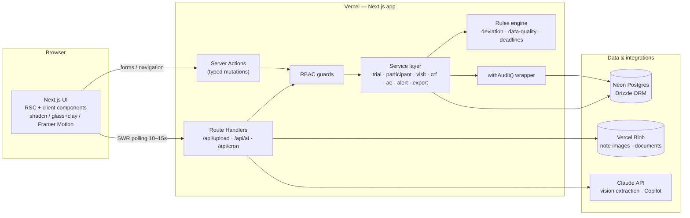
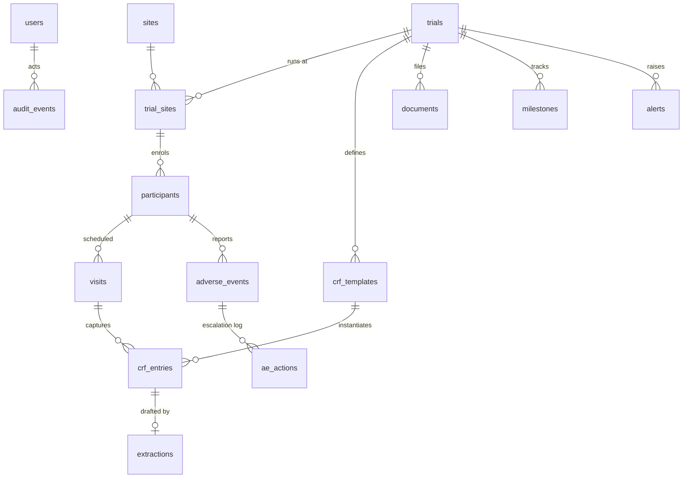
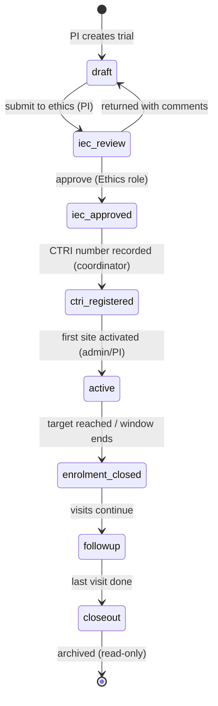

# Architecture Claim vs Code — vansh459_AyuSphere

**Repository:** `vansh459_AyuSphere`
**Generated:** 2026-09-30

## Presented Architecture — File: `docs\ARCHITECTURE.md` (17.4 KB)

```markdown
# AyuSphere — Architecture Document

System architecture for the AyuSphere CTMS. Stack rationale lives in [technology.md](technology.md), decisions in [decisions.md](decisions.md), end-to-end flows in [workflow.md](workflow.md).

---

## 1. System overview

Single Next.js full-stack application (D-001) on Vercel, backed by Neon Postgres, calling the Claude API for the two AI capabilities, storing files in Vercel Blob.



**Request paths**

- **Reads:** RSC pages query the service layer directly on the server; client dashboards revalidate through lightweight GET route handlers with SWR (D-011).
- **Writes:** always server actions → RBAC guard → Zod parse → service → rules evaluation → Drizzle transaction → audit event. No client ever touches the DB shape directly.
- **AI:** route handlers only (`/api/ai/extract`, `/api/ai/copilot`) so streaming and file handling stay off the action path.
- **Cron:** `/api/cron/alerts` (Vercel Cron — daily on Hobby, 10 min on Pro; write-time evaluation covers intra-day) sweeps time-based alert rules (overdue visits, approaching AE deadlines) that writes alone can't trigger.

## 2. Layered architecture

| Layer | Location | Responsibility | Rule |
|---|---|---|---|
| Presentation | `src/app`, `src/components` | Pages, forms, charts, motion | No business logic; renders service DTOs |
| Application | server actions + `src/services` | Use-cases, transactions, audit | Every mutation wrapped in `withAudit()` (D-010) |
| Domain | `src/lib/schemas`, `src/lib/rules` | Zod schemas, lifecycle state machine, deviation/data-quality/deadline rules | Pure TypeScript, unit-testable, no I/O |
| Data | `src/db` | Drizzle schema, queries, seed | Only services import it |
| Integration | `src/lib/ai`, export builders | Claude prompts + parsers, FHIR/SDTM mappers | AI output parsed through domain Zod schemas — AI can never bypass validation (D-012) |

## 3. Data model

### 3.1 Entity relationships



### 3.2 Tables (Drizzle schema, CDASH-aligned naming — D-017)

| Table | Key fields | Notes |
|---|---|---|
| `users` | id, email, password_hash, name, **role** (enum: `pi · coordinator · monitor · ethics · pv · admin · regulator`), site_id?, active | Seeded demo user per role |
| `trials` | id, ctri_number?, title, protocol_code, study_type (interventional/observational), phase, intervention (Ayurveda formulation, dosage form), target_enrollment, **status** (lifecycle enum), planned_start/end | Status transitions guarded by state machine (§4) |
| `sites` | id, name, city, state, pi_user_id | |
| `trial_sites` | trial_id, site_id, activation_status, activated_at, enrollment_target, monitoring_visit_due | Per-site targets drive recruitment analytics |
| `participants` | id, **subject_code** (de-identified, e.g. `AYU-001-P-0042`), trial_site_id, screening_status, eligibility, arm (randomization), consent_status, consent_date, enrolled_at, withdrawal_reason?, status | **No name/phone/address columns exist** — de-identification by schema (D-016) |
| `crf_templates` | id, trial_id, visit_type, name, version, fields (JSONB: name, label, type, unit, min, max, required, cdash_var) | Field rules compile to Zod at runtime (D-012) |
| `visits` | id, participant_id, template_id, visit_number, scheduled_date, **window_start/window_end**, completed_at?, status (upcoming/due/overdue/completed/missed) | Windows computed from protocol offsets |
| `crf_entries` | id, visit_id, template_id, data (JSONB), status (draft/submitted/approved), entered_by, approved_by?, approved_at?, source (`manual` \| `extraction`), extraction_id? | `approved` rows immutable — corrections create new versions |
| `extractions` | id, blob_url, image_quality (JSONB), raw_output (JSONB), mapped_fields (JSONB with **per-field confidence**), model_id, prompt_version, status (pending/review/approved/rejected), reviewed_by?, reviewed_at? | Full provenance for Doctor Note Intelligence (§6) |
| `adverse_events` | id, participant_id, term, meddra_code?, whodrug_code?, onset_date, **seriousness** (AE/SAE), severity, outcome, causality, narrative, **reporting_deadline**, reported_at?, status (open/under_review/reported/closed) | Deadline computed at insert (§7) |
| `ae_actions` | id, ae_id, action, actor_id, at | Escalation timeline |
| `documents` | id, trial_id, kind (protocol/ethics_approval/consent_form/monitoring_report/regulatory), version, blob_url, uploaded_by | Version history = one row per version |
| `milestones` | id, trial_id, kind (**iec_submission, iec_approval, ctri_registration**, first_enrolment, last_visit, closeout), due_date, completed_at? | Drives CTRI/ethics due alerts |
| `alerts` | id, trial_id?, site_id?, rule_key, severity, message, entity_ref, status (open/acknowledged/resolved), created_at | Written by rules engine, surfaced role-filtered |
| `signatures` | id, actor_id, actor_role, entity_type, entity_id, action (approve/correct/report), **meaning**, **payload_hash** (SHA-256), signed_at | E-signature per record-freezing action (D-022); inserted in the same transaction as the mutation it signs |
| `monitoring_visits` | id, trial_site_id, monitor_id, scheduled_date, completed_at?, summary, findings (JSONB), report_document_id? | Monitor's site visits (T7.3); completing advances `trial_sites.monitoring_visit_due` by the configured cadence |
| `audit_events` | id, actor_id, actor_role, action, entity_type, entity_id, before (JSONB), after (JSONB), at, request_id | **INSERT-only** (§5) |

## 4. Trial lifecycle state machine

The PS's lifecycle chain is enforced as an explicit state machine in `src/lib/rules/lifecycle.ts` — services refuse invalid transitions; the ethics gate belongs to the ethics role only.



Guards worth noting: a trial cannot reach `active` without an `iec_approval` milestone **and** a `ctri_number` (prospective-registration rule
... [truncated]
```

- **Frontend:** not mentioned in presented doc
- **Backend:** not mentioned in presented doc
- **Database:** found — `database, not by convention.`
- **AI:** found — `AI capabilities, storing files in Vercel Blob.`
- **External APIs:** not mentioned in presented doc
- **Cloud:** not mentioned in presented doc
- **Authentication:** found — `authentication + signature meaning + SHA-256 payload hash + timestamp in the `signatures` table, committed atomically wi`
- **Data flow:** found — `data flows through the normal validate → submit → signed-approve path, never auto-committing.`
- **Integration:** found — `integrations"]`


## Actual Code Architecture (verified)

See `analysis/vansh459_AyuSphere/ARCHITECTURE.md:1` (diagram with evidence: `server/src/modules/*/routes.ts:1`, `schema.ts`, `package.json`).

## Comparison — Presented vs Actual

| Layer | Presented (from ARCHITECTURE.md) | Actual (from code) | Difference |
|---|---|---|---|
| Frontend | Yes (presented) | Yes (code: True) | Check if presented matches Vite/Next vs code |
| Backend | Yes | Yes | See ARCHITECTURE.md |
| Database | Mentioned | Yes | Verify schema.ts |
| AI | Mentioned | Yes (AyuSphere only) | Only AyuSphere has code |
| Cloud | Mentioned if vercel/render in doc | See deployment (vercel.json/render.yaml) |
| Authentication | Mentioned | See REPO_ANALYSIS 7. Auth |
| Data flow | Mentioned | See ARCHITECTURE.md diagram |

> **Rule:** If presented says ABDM integrated but code search `ABDM` 0 hits → CLAIMED ONLY vs NOT PRESENT.

